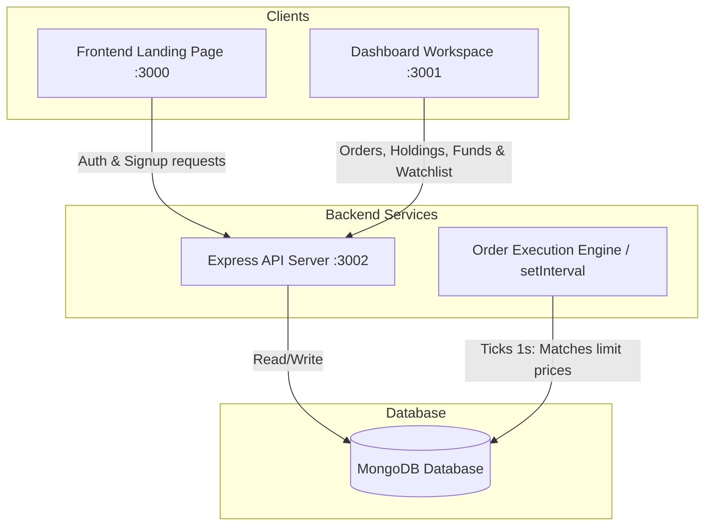

# AlphaTrade 📈

AlphaTrade is a full-featured, modern **MERN (MongoDB, Express, React, Node.js) stack trading platform clone** inspired by premium stock broker interfaces like Zerodha Kite. The application is split into three distinct modules to separate public marketing pages, an authenticated real-time trading dashboard, and a robust backend powered by a background order execution engine.

---

## 🚀 Key Features

*   **Premium Public Portal (Frontend):** Interactive marketing site built with React & Bootstrap, featuring a clean landing, About page, Product details, Pricing calculators, Support portals, and authentication screens (Sign Up / Sign In).
*   **Real-time Trading Dashboard (Dashboard):** Rich trading workspace styled with **Material UI (MUI)** and **Emotion**, visualizing portfolios with **Chart.js** (Doughnut & Bar charts), managing watchlists, and maintaining user order books.
*   **Order Execution Engine (Backend):** An autonomous background order-matching system running on a `setInterval` ticker (every 1 second). It dynamically matches pending limit orders against fluctuating market watchlists and promotes them to active portfolio **Holdings**.
*   **Funds Ledger Management:** Complete deposit and withdrawal tracking linked to MongoDB schemas, helping mock users fund their accounts dynamically.
*   **Secured Credentials:** Authentication flow utilizing `bcryptjs` for industry-standard password hashing and security.

---

## 🛠️ Technology Stack

| Layer | Technologies & Libraries |
| :--- | :--- |
| **Frontend (Landing Page)** | React 18, React Router v7, Bootstrap 5, FontAwesome 7, Axios |
| **Dashboard (Trading Client)** | React 18, React Router v6, Material UI v5, Emotion, Chart.js, React ChartJS 2, Axios |
| **Backend API Server** | Node.js, Express.js, Mongoose (MongoDB ODM), BcryptJS, Cors, Dotenv |
| **Database** | MongoDB Atlas / Local MongoDB |

---

## 🏛️ System Architecture



---

## 📁 Repository Structure

```text
alphatrade/
├── backend/                  # Express REST API Server
│   ├── model/                # Mongoose Database Models (Holding, Position, Order, User, Balance)
│   ├── routes/               # API endpoint routing logic (e.g., /balance)
│   ├── schemas/              # Mongoose DB Schemas
│   ├── utils/                # Order matching and custom helper scripts
│   ├── .env                  # Environment configurations (Port, DB URI)
│   ├── index.js              # Application entrypoint & live server ticker
│   └── package.json
│
├── dashboard/                # Authenticated trading desk (React/MUI)
│   ├── public/               # Static web assets
│   ├── src/
│   │   ├── components/       # WatchList, Holdings, Positions, Orders, Charts, etc.
│   │   ├── context/          # State management
│   │   ├── data/             # Watchlist static listings and dynamic price lists
│   │   ├── index.css         # Custom layout overrides & custom variables
│   │   └── index.js          # App mounting point
│   └── package.json
│
└── frontend/                 # Public landing & Marketing portal (React/Bootstrap)
    ├── public/               # Public images & assets
    ├── src/
    │   ├── landing_page/     # Dedicated pages (Home, About, Pricing, Support, Signin/Signup)
    │   ├── index.css         # Global styling definitions
    │   └── index.js          # Router setup & layout loading
    └── package.json
```

---

## 🔧 Installation & Set Up

Follow the steps below to configure and run the entire development ecosystem locally:

### 1. Prerequisites
- **Node.js** (v16.x or newer recommended)
- **NPM** (v8.x or newer)
- **MongoDB** (Local instance or MongoDB Atlas Cloud instance URI)

---

### 2. Backend Setup
1. Open your terminal and navigate to the backend folder:
   ```bash
   cd backend
   ```
2. Install dependencies:
   ```bash
   npm install
   ```
3. Create a `.env` file in the root of the `/backend` directory and add your MongoDB connection URL:
   ```env
   PORT=3002
   MONGO_URL=your_mongodb_connection_uri
   ```
4. Start the backend development server using nodemon:
   ```bash
   npm start
   ```
   *The server will start on port `3002` (or your defined port) and immediately initialize the database connection.*

#### 💡 Seeding Mock Data
When starting with a fresh database, trigger these seeding endpoints in your browser or Postman **once** to pre-populate mock market holdings and open positions:
- **Seed Holdings:** `http://localhost:3002/addHoldings`
- **Seed Positions:** `http://localhost:3002/addPositions`

---

### 3. Dashboard Setup
1. Navigate to the dashboard directory:
   ```bash
   cd ../dashboard
   ```
2. Install dependencies:
   ```bash
   npm install
   ```
3. Run the dashboard development server:
   ```bash
   npm start
   ```
   *The dashboard will compile and launch at `http://localhost:3001` (or fall back to an available port if port conflicts arise).*

---

### 4. Frontend Setup
1. Navigate to the frontend directory:
   ```bash
   cd ../frontend
   ```
2. Install dependencies:
   ```bash
   npm install
   ```
3. Launch the landing page:
   ```bash
   npm start
   ```
   *The frontend marketing website will boot up on `http://localhost:3000`.*

---

## ⚡ Core Domain Logic: Order Matcher Engine

AlphaTrade uses an active orders table matched dynamically against stock movements. Inside `backend/utils/executeOrder.js`:

```javascript
// A recurring 1-second interval maps all open limit orders against live watchlist quotes.
const executePendingOrders = async () => {
  const allOrders = await Orders.find(); 
  for (const order of allOrders) {
    const stock = watchlist.find((s) => s.name === order.name);
    if (!stock) continue;

    // Checks if the user's limit price falls within a threshold of market value
    if (Math.abs(stock.price - order.price) <= 0.5) {
      // 1. Checks if holding exists: updates aggregate quantity and average acquisition cost
      // 2. Otherwise: creates a brand-new holding node
      // 3. Removes executed limit order from the pending order table
    }
  }
};
```

---

## 📊 Database Entities (Mongoose)

### **Holding Schema**
```javascript
{
  name: String,      // Stock Symbol (e.g., INFY)
  qty: Number,       // Aggregate purchased quantities
  avg: Number,       // Average acquisition price
  price: Number,     // Last traded price (LTP)
  net: String,       // Percent return (Net P&L)
  day: String        // Daily price change percentage
}
```

### **Order Schema**
```javascript
{
  name: String,      // Stock Symbol
  qty: Number,       // Ordered quantity
  price: Number,     // Placed limit price
  mode: String       // Order transaction type ("BUY" / "SELL")
}
```

### **User Schema**
```javascript
{
  name: String,      // User Display Name
  email: String,     // Registered email id (unique)
  password: String,  // Bcrypt hashed password
  createdAt: Date    // Account creation date
}
```

### **Balance Schema**
```javascript
{
  userId: String,    // Owner ID link
  balance: Number    // Available cash ledger
}
```

---

## 🤝 Contributing
1. Fork the Project Repository.
2. Create your Feature Branch (`git checkout -b feature/AmazingFeature`).
3. Commit your Changes (`git commit -m 'Add some AmazingFeature'`).
4. Push to the Branch (`git push origin feature/AmazingFeature`).
5. Open a Pull Request.

---

## 📝 License
This project is open-sourced under the [ISC License](LICENSE). Feel free to modify, deploy, and utilize it in learning endeavors!
